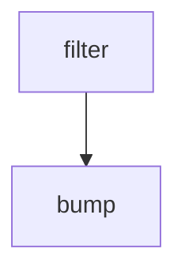

# bump-vm-images

Documents the bump-vm-images GitHub Actions workflow and its configured execution.

## At a glance

| | |
| --- | --- |
| Platform | GitHub Actions |
| Source | [`.github/workflows/bump-vm-images.yml`](../bump-vm-images.yml) |
| Trigger | `workflow_dispatch`, `schedule` (scheduled) |

## Purpose

Runs the configured `filter`, `bump` job(s) for **bump-vm-images**. The checked-in source does not state a separate historical rationale.

## When it runs

- `workflow_dispatch`.
- `schedule`: Runs on a schedule. See the [workflow configuration](../bump-vm-images.yml) for current timing.

## Execution flow

| Job | Runs when / runner | Depends on | Configured work |
| --- | --- | --- | --- |
| filter | runner `ubuntu-slim` | None declared | generator uses `elastic/oblt-actions/elastic/active-branches@v1`; generator input names `["filter-branches"]`; outputs `["matrix"]` |
| bump | runner `ubuntu-latest; matrix '${{ fromJson(needs.filter.outputs.matrix) }}'` | `["filter"]` | Step uses `actions/checkout@v7`; Step input names `["ref"]`; Step uses `elastic/oblt-actions/updatecli/run@v1`; Step input names `["command", "version-file"]`; Step uses `elastic/oblt-actions/slack/send@v1`; Step input names `["bot-token", "channel-id", "message"]` |

## Inputs, outputs, and access

| Item | Details |
| --- | --- |
| Inputs | elastic/oblt-actions/elastic/active-branches@v1 input names: filter-branches; actions/checkout@v7 input names: ref; elastic/oblt-actions/updatecli/run@v1 input names: command, version-file; elastic/oblt-actions/slack/send@v1 input names: bot-token, channel-id, message |
| Outputs | filter: matrix |
| Permissions | workflow: `{"contents": "read"}`; filter: `{"contents": "read"}`; bump: `{"contents": "write", "pull-requests": "write"}` |
| Secrets | `GITHUB_TOKEN`, `SLACK_BOT_TOKEN` |

## Operational notes

Local composite actions and shell scripts used by this workflow are linked under Sources. External actions are identified by their `uses` reference in the job table; their implementation is maintained outside this repository.

## Sources

- Workflow: [`.github/workflows/bump-vm-images.yml`](../bump-vm-images.yml)
- Local dependency: [`.github/workflows/updatecli.d/updatecli-bump-vm-images.yml`](../updatecli.d/updatecli-bump-vm-images.yml)
- Local dependency: [`.github/workflows/updatecli.d/values.d/scm.yml`](../updatecli.d/values.d/scm.yml)
