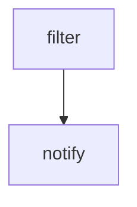

# notify-stalled-snapshots

Documents the notify-stalled-snapshots GitHub Actions workflow and its configured execution.

## At a glance

| | |
| --- | --- |
| Platform | GitHub Actions |
| Source | [`.github/workflows/notify-stalled-snapshots.yml`](../notify-stalled-snapshots.yml) |
| Trigger | `workflow_dispatch`, `schedule` (scheduled) |

## Purpose

Runs the configured `filter`, `notify` job(s) for **notify-stalled-snapshots**. The checked-in source does not state a separate historical rationale.

## When it runs

- `workflow_dispatch`.
- `schedule`: Runs on a schedule. See the [workflow configuration](../notify-stalled-snapshots.yml) for current timing.

## Execution flow

| Job | Runs when / runner | Depends on | Configured work |
| --- | --- | --- | --- |
| filter | runner `ubuntu-latest` | None declared | generator uses `elastic/oblt-actions/elastic/active-branches@v1`; outputs `["matrix"]` |
| notify | runner `ubuntu-latest; matrix '${{ fromJson(needs.filter.outputs.matrix) }}'` | `["filter"]` | Step uses `actions/checkout@v7`; Step input names `["fetch-depth", "ref"]`; date runs a shell command; search runs a shell command; Step uses `elastic/oblt-actions/slack/send@v1`; Step input names `["bot-token", "channel-id", "message"]` |

## Inputs, outputs, and access

| Item | Details |
| --- | --- |
| Inputs | actions/checkout@v7 input names: fetch-depth, ref; elastic/oblt-actions/slack/send@v1 input names: bot-token, channel-id, message |
| Outputs | filter: matrix |
| Permissions | workflow: `{"contents": "read"}` |
| Secrets | `SLACK_BOT_TOKEN` |

## Operational notes

Local composite actions and shell scripts used by this workflow are linked under Sources. External actions are identified by their `uses` reference in the job table; their implementation is maintained outside this repository.

## Sources

- Workflow: [`.github/workflows/notify-stalled-snapshots.yml`](../notify-stalled-snapshots.yml)
